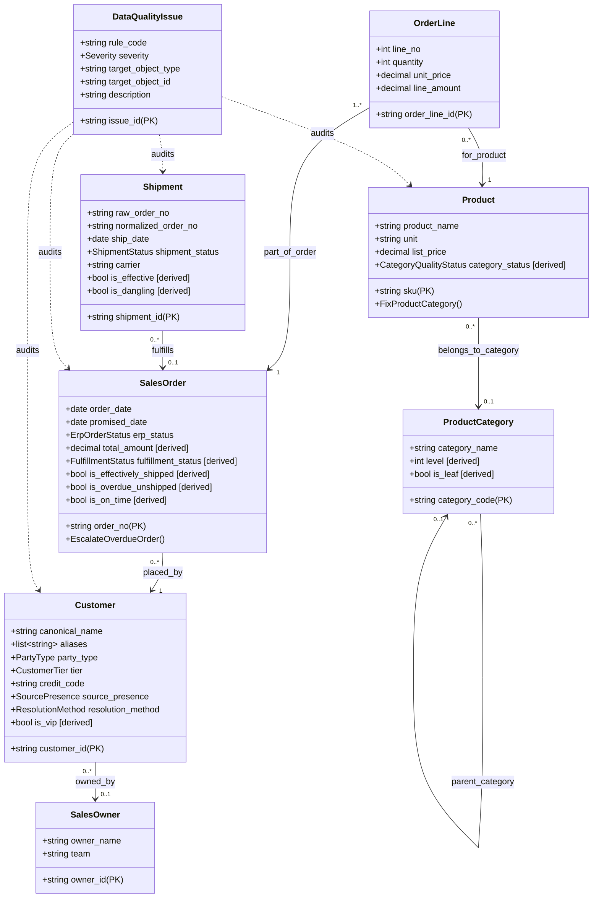

# 阶段二：Ontology 概念设计

本文档记录如何从真实的企业异构系统（CRM / ERP / WMS）与核心业务问题（CQ1–CQ4）出发，提炼出一套可落地的 Ontology 概念模型。对应的机器可读规范已固化在 [schema.yaml](../ontology/schema.yaml)。

---

## 1. 设计 Ontology 概念的 5 条核心原则

在真实企业里设计 Ontology，**最大的误区就是把源系统的物理表 1:1 抄一遍，只是换个英文名**。真正好的本体设计遵循 5 条原则：

### 原则一：按“真实世界实体”建模，而不是按“系统表”建模
- **反例**：分别建 `CrmAccount` 和 `ErpCustomer` 两个对象——这只是把数据孤岛搬进了新仓库。
- **正例**：只建一个真实世界概念 **`Customer`（客户 / 业务参与方）**。CRM 账号和 ERP 客户编号退化为它的**外部血缘标识（External IDs）**，由实体解析（Entity Resolution）规则将它们汇聚到同一个 `CUST-xxxx` 规范对象上。

### 原则二：严格区分 4 种建模元素，不要什么都往属性里塞
| 建模元素 | 什么时候用 | 本场景举例 |
| :--- | :--- | :--- |
| **Object Type（对象类型）** | 有独立身份、独立生命周期、会被多处引用的核心业务事物 | `Customer`, `SalesOwner`, `Product`, `ProductCategory`, `SalesOrder`, `OrderLine`, `Shipment` |
| **Controlled Vocabulary（受控词表/枚举）** | 跨系统叫法不统一、需要统一业务口径的分类值 | `CustomerTier`, `PartyType`, `FulfillmentStatus`, `ShipmentStatus` |
| **Link Type（语义关系）** | 对象之间的业务连接，表达真实动作或归属，而非冰冷的裸外键 | `placed_by`, `owned_by`, `fulfills`, `parent_category` |
| **Derived Property（派生属性）** | 由明确业务规则计算得出的高层语义状态，避免每个查询重复写一遍 `CASE WHEN` | `is_vip`, `fulfillment_status`, `is_overdue_unshipped`, `is_on_time` |

### 原则三：把“口头约定的业务口径”写成显式的语义规则
现实中各部门吵架，90% 是因为同一个词含义不同。设计 Ontology 时必须把关键语义**拍板写死**：
1. **权威事实源裁决（Source of Truth）**：
   - 订单“是否已发货”以 **WMS `Shipment`** 为唯一权威源，不轻信可能滞后的 ERP `status_code`。
   - 客户规范名称优先取 **ERP 工商全称**，同时保留 CRM 简称和更名前旧名到 `aliases`。
2. **明确术语边界**：
   - `CustomerTier.VIP` 只接收 CRM 的 `VIP` / `vip`；`大客户` 独立映射为 `KEY_ACCOUNT`，不混入 VIP。
   - 只有 WMS 状态为 `已出库 (IN_TRANSIT)` 或 `已签收 (DELIVERED)` 才算 `有效发货 (is_effective = true)`，`待出库 (AWAITING_DISPATCH)` 不算。

### 原则四：把“现实数据的不完美”设计为一等公民
真实企业数据永远有脏数据。如果模型要求“所有外键必须严格存在、所有日期必须非空”，接入第一天管道就会崩掉；如果悄悄过滤掉，业务指标就会丢数。
- **容错建模**：允许 `Shipment.fulfills` 为空（承载孤立发货单），允许 `SalesOrder.promised_date` 为空，允许 `Product.belongs_to_category` 在冲突时悬空。
- **治理对象**：显式引入 **`DataQualityIssue`（数据质量与一致性异常）** 对象类型，配合 12 条显式规则（`DQ-001` ~ `DQ-012`），让每一条脏数据既不阻塞业务，又能被精准审计追踪。

### 原则五：为“行动（Action）”预留语义挂载点
现代企业本体不只是静态查询字典，还要支持闭环操作。因此在对象类型上直接定义可执行动作（如绑定在 `SalesOrder` 上的 `EscalateOverdueOrder`）及其前置条件，为后续业务应用和 AI Agent 调用建立受控边界。

---

## 2. 本体概念全景图

---

## 3. 源系统物理表 → 本体对象的收敛映射

从“10 张源系统物理表”收敛到“8 个高内聚业务概念”：

| 本体对象类型 | 数据来源（物理表） | 关键语义转换 |
| :--- | :--- | :--- |
| `Customer` | `crm/accounts.csv` + `erp/customers.csv` + `erp/customer_type_codes.csv` | 按 `信用代码 > 精确名称 > 人工映射表` 做实体解析合并；归一化 `CustomerTier` 与 `PartyType`；记录 `source_presence` |
| `SalesOwner` | `crm/owners.csv` | 直接映射为内部组织人员实体 |
| `ProductCategory` | `erp/category_codes.csv` | 构建树形自反关系 `parent_category`，派生 `level`、`is_leaf` 与一级大类 `root_category` |
| `Product` | `erp/products.csv` | 校验原始分类码/名与标准分类树的一致性，生成 `category_status`；仅可信节点建立 `belongs_to_category` 链接 |
| `SalesOrder` | `erp/sales_orders.csv` + `erp/order_status_codes.csv` | 标准化多种日期格式；聚合 `OrderLine` 得到总金额；结合 WMS `Shipment` 裁决 `fulfillment_status` 与 `is_overdue_unshipped` |
| `OrderLine` | `erp/order_items.csv` | 清洗含千分位逗号的金额字段，生成全局明细键 `{order_no}#{line_no}` |
| `Shipment` | `wms/shipments.csv` | 标准化缺失连字符的订单号以关联 `SalesOrder`；区分 `待出库` 与有效发货；孤立单标记 `is_dangling` |
| `DataQualityIssue` | 跨三系统规则引擎自动产出 | 按 `DQ-001` ~ `DQ-012` 约束扫描生成，挂接目标对象与原始证据 |

---

## 4. 关键设计裁决说明（为什么这样设计？）

1. **为什么把 `ProductCategory` 独立成对象，而不是作为 `Product` 的两个字符串字段？**
   - 源系统 `products.csv` 里的 `category_code` 和 `category_name` 存在冗余和自相矛盾（如 `P-1013` 码是硒鼓、名是打印机）。将 `ProductCategory` 独立成自反树形对象后，一方面可通过传递闭包向上自动聚合任意层级（支撑 CQ3），另一方面能把“分类码不存在”“挂在非叶子节点”“码名冲突”清晰转化为图约束校验。
2. **为什么 `P-1015`（挂在非叶子节点 `01` 办公设备）和 `P-1013`（码名冲突）的处理不同？**
   - `P-1015` 的一级大类语义是明确的（就是 `01 办公设备`），只是缺少二级细类，因此保留 `belongs_to_category -> 01` 并打标 `NON_LEAF`（`DQ-010`）。
   - `P-1013` 的码（硒鼓）和名（打印机）互相打架，机器无法判断哪个才是真相，宁可留空 `belongs_to_category` 并标记 `CONFLICT`（`DQ-008`）交给人审核，也不能瞎猜污染报表。
3. **为什么 CRM `ACC-1006`（星辰设计，缺信用代码）不靠模糊子串匹配去自动合并？**
   - 因为数据里同时存在 `ACC-1001`（云帆科技）和 `ACC-1008`（新云帆网络）。靠简单的字符串包含/相似度自动合并，极易把不同法人错并在一起！
   - 企业级实体解析的标准做法是**分级置信度策略**：
     - **L1 强自动合并**：统一社会信用代码完全一致（自动解决 `博思咨询` ↔ `远东管理咨询有限公司` 更名问题）。
     - **L2 受控精确合并**：名称完全一致 + 主体类型一致 + 城市一致（自动解决个人客户 `张三`、同名企业 `恒信律师事务所`）。
     - **L3 人工审核映射表（Crosswalk）**：对于既缺信用代码、简称又与全称不同的记录（如 `ACC-1006 星辰设计` ↔ `C0006 星辰创意设计有限公司`），通过受版本管控的人工映射表显式确认，绝不“黑盒猜合并”。

---

## 5. 用 CQ1–CQ4 反向验收当前设计

| 业务问题 | 在本体层如何回答？ | 涉及的核心概念与规则 |
| :--- | :--- | :--- |
| **CQ1：近 30 天 VIP 逾期未发货** | 直接筛选 `SalesOrder`：`placed_by.is_vip == true` ∧ `order_date >= 2026-10-25` ∧ `is_overdue_unshipped == true`，沿 `placed_by -> owned_by` 取出销售与团队 | `Customer.is_vip`、`SalesOrder.is_overdue_unshipped`、`Shipment.is_effective`、`placed_by`、`owned_by` |
| **CQ2：客户 360° 全景** | 遍历全部 `Customer` 对象，直接读取 `source_presence`、`tier`、`owned_by`，并沿反向链接汇总其 `SalesOrder` 的有效金额与 `is_on_time` 比例 | `Customer` 实体解析、`source_presence`、`SalesOrder.total_amount`、`SalesOrder.is_on_time` |
| **CQ3：品类大类聚合与审计** | 从 `OrderLine -> for_product -> belongs_to_category -> parent_category*` 上卷至一级大类汇总金额；同时筛选 `Product.category_status != VALID` 输出异常清单 | `ProductCategory` 树传递闭包、`Product.category_status` |
| **CQ4：跨系统一致性审计** | 直接按 `severity` / `rule_code` 查询 `DataQualityIssue` 对象集合 | `DataQualityIssue` 及 `DQ-001` ~ `DQ-012` |

---

## 下一步

概念模型与规范（[schema.yaml](../ontology/schema.yaml)）已就绪。下一阶段（**阶段三：语义映射与实体解析**）将编写本体构建引擎：
1. 读取三套源系统 CSV + 受控人工映射表（Crosswalk）；
2. 执行清洗、标准化、三级实体解析与派生属性计算；
3. 将完整的本体实例（Objects + Links + DataQualityIssues）实例化落盘（如 SQLite / JSON 图谱，便于后续直接查询、可视化或接入 AI Agent）。
